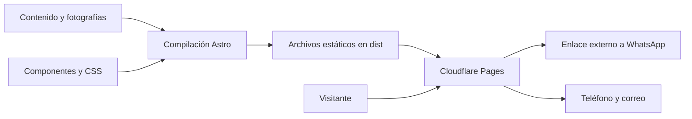

# Arquitectura del proyecto CONSUC SAC

Estado: primera versión funcional de la landing implementada para revisión local.
Actualización: 19 de noviembre de 2026.

## Objetivo y alcance actual

Desarrollar una landing corporativa en español que presente CONSUC SAC, explique sus seis categorías de servicios y facilite el contacto por WhatsApp, teléfono y correo. Todo el contenido principal se muestra en una página con navegación por secciones.

La primera versión incluye diseño responsive, identidad visual del brochure, imágenes de referencia identificadas, contenido empresarial, servicios y enlaces de contacto. El brochure se usa solo como fuente interna: no se aloja, incrusta ni ofrece para descarga en la web. Las páginas independientes de servicio, panel, formularios, adjuntos, base de datos, autenticación y portal de clientes quedan para ampliaciones futuras.

Esta decisión sustituye la arquitectura inicial con Next.js y PostgreSQL, que respondía al alcance completo. No se necesita mantener un servidor ni contratar una base de datos para la landing.

Fuentes: `guia_estilo_y_disenio.md`, brochure de seis páginas y referencias entregadas por el usuario. El brochure aporta contenido e identidad, no instrucciones de desarrollo. Los datos pendientes de confirmación no se presentan como verificados.

## Tecnologías

| Tecnología | Responsabilidad |
| --- | --- |
| Astro | Generar HTML estático para la landing y futuras páginas de contenido. |
| TypeScript | Tipar datos, configuración y utilidades. |
| CSS | Estilos por componente y variables de marca; aprovechar los tokens existentes. |
| JSON | Separar empresa, servicios y navegación del diseño. |
| Markdown y colecciones | Incorporarlos al añadir fichas o textos extensos; opcionales para la landing. |
| JavaScript del navegador | Menú móvil y otras interacciones justificadas. WhatsApp funciona como enlace. |
| Cloudflare Pages | Alojamiento estático recomendado, con URL temporal de revisión y dominio posterior. |
| Git | Commits por avance y control de versiones. |

Astro y las dependencias están instalados con pnpm y archivo de bloqueo. TypeScript usa una versión compatible con `@astrojs/check`. Incorporar React, CMS o servicios externos solo cuando una función los requiera.

## Flujo del sistema



Los cambios de contenido requieren compilar y desplegar de nuevo. Inicialmente el desarrollador actualiza los archivos mediante Git. WhatsApp abre una conversación con mensaje predefinido; no requiere API, bot ni servidor propio. El clic no acredita envío del mensaje ni genera una consulta registrada.

## Ruta y secciones

Ruta pública inicial: `/`. El menú usa anclas; los slugs de servicios son identificadores de contenido y no crean páginas de detalle en esta etapa.

| Ancla | Contenido |
| --- | --- |
| `#inicio` | Presentación, imagen principal y CTA de WhatsApp. |
| `#nosotros` | Empresa, trayectoria desde 2020, ubicación, misión y visión. |
| `#servicios` | Seis categorías con resumen, alcance y WhatsApp contextual. |
| `#galeria` | Opcional: imágenes de referencia rotuladas como tales; no representan trabajos de CONSUC. Sustituirlas cuando lleguen fotos propias aprobadas. |
| `#clientes` | Omitir por ahora: solo están autorizados los logos corporativos disponibles en `imgs/Logos`, no los logos de clientes del brochure. |
| `#seguridad-calidad` | Compromisos documentados y acreditaciones solo con alcance y vigencia revisados. |
| `#contacto` | Teléfonos, correos, dirección y WhatsApp. |

El pie contiene razón social, RUC y enlaces útiles. El botón «Cotizar por WhatsApp» abre el contacto externo al +51 989 522 797. No incluir PDF, descarga ni visor del brochure. No inventar fichas de proyectos a partir de fotografías.

Las seis categorías se conservan en `src/content/services.json`. `src/content/routes.json` distingue las secciones actuales de las rutas de una posible ampliación.

## Estructura prevista

```text
public/
  favicon.svg
src/
  assets/                      # Logos y fotografías para optimización
  components/
    layout/                    # Cabecera, menú y pie
    sections/                  # Inicio, Nosotros, Servicios, Galería y Contacto
    ui/                        # Botones, tarjetas y enlace WhatsApp
  content/
    company.json               # Empresa y contactos
    services.json              # Seis servicios
    routes.json                # Ruta, anclas y ampliaciones
    media-policy.json          # Logos autorizados y uso de referencias
  layouts/
    BaseLayout.astro           # HTML base, metadatos y estilos
  pages/
    index.astro                # Composición de la landing
    404.astro
  lib/
    whatsapp.mjs               # Generación y codificación de enlaces
  styles/
    tokens.css
    global.css
  contracts/
    inquiry.schema.json        # Referencia futura, fuera de la landing
scripts/
docs/
astro.config.mjs
tsconfig.json
package.json
```

La aplicación está implementada con esta organización. El favicon reside en `public/`; los logos se importan desde la carpeta autorizada. No se incluye una ruta o PDF del brochure. El contenido continúa sujeto a revisión editorial antes de publicar. El contrato de consultas sigue reservado para una ampliación.

Las secciones reciben datos y componen componentes. Leer contactos de una sola fuente; evitar números y correos repetidos en el marcado. Mantener las utilidades independientes del contenido editorial. La escala inicial no requiere microservicios, monorepositorio ni capas de acceso a bases de datos.

## Diseño, contenido y accesibilidad

Preservar azul `#1C2A39`, naranja `#F27D16`, verde `#54B948`, blanco y gris hielo. Usar Montserrat e Inter cuando se incorporen archivos con licencia, con alternativas del sistema. Cuerpo desde 16 px y títulos fluidos mediante `clamp()`.

Conservar encabezados numerados, subrayados de 60 × 4 px, viñetas cuadradas, fotos con radio de 10 px y etiquetas azules con borde naranja. Ajuste a la guía: texto azul oscuro sobre botones naranjas para mejorar el contraste. Distinguir las cuatro líneas corporativas del brochure de las seis categorías web.

Usar únicamente las variantes de logo de `imgs/Logos`, conservar los originales y generar derivados optimizados. Mientras el cliente reúne las fotografías, utilizar imágenes de referencia con procedencia y condiciones de uso registradas y etiqueta «Imagen referencial». No atribuirlas a proyectos, instalaciones o personal de CONSUC. Preparar su sustitución por imágenes propias aprobadas sin modificar la estructura. Imágenes con texto alternativo, tamaños adecuados, dimensiones declaradas y formatos modernos; carga diferida fuera de la vista inicial, sin diferir la imagen principal.

HTML semántico, un H1, jerarquía de títulos, enlace para saltar al contenido y foco visible. Menú móvil con teclado, estado expandido y cierre con Escape. Respetar movimiento reducido.

Clientes, AWS, SGS y código vendor siguen `fuentes-y-contenido.md`. No inventar resultados, coordenadas o enlaces sociales. Si falta material, continuar con las demás secciones y omitir lo pendiente de confirmación.

## Publicación y posicionamiento

La primera propuesta se prepara para GitHub Pages mediante `.github/workflows/pages.yml`, por preferencia del usuario, con URL prevista `https://dan1elmon.github.io/CONSUC/`. Activar Source: GitHub Actions en Settings → Pages y enviar el workflow al remoto antes de considerar disponible el enlace. Cloudflare Pages sigue siendo la opción para evaluar el alojamiento comercial definitivo. Esta configuración no cambia la visibilidad del repositorio.

Compilación: `pnpm build`; salida `dist/`. El workflow comprueba tipos e inventario, compila, ejecuta las pruebas y publica solo esa salida. Se ejecuta al enviar cambios a `main` o de forma manual; la versión anterior permanece si falla la verificación. Los commits locales se mantienen separados de la publicación.

El workflow establece origen `https://dan1elmon.github.io`, base `/CONSUC` e indexación desactivada. Favicon, página 404, CSS e imágenes respetan la base. La configuración local y un dominio propio usan base `/`. Consultar activación, límites y resolución de fallos en el README. No hay archivos PDF en el sitio.

Incluir título, descripción, idioma, favicon y metadatos para compartir. Configurar URL canónica y sitemap con el dominio definitivo. Las vistas de revisión usarán `noindex`, que no equivale a privacidad ni control de acceso. No publicar material confidencial.

No añadir analítica, cookies de seguimiento, formularios o mapas de terceros por defecto. Revisar sus implicaciones si se solicitan. Dominio y cuentas deben quedar bajo control del cliente o con un acuerdo claro de administración; no hace falta comprar dominio para empezar.

## Verificación de entrega

- Catálogo de seis servicios coherente y navegación mediante anclas.
- Compilación de producción, comprobación de tipos y pruebas del build con los scripts de `package.json`.
- Revisión visual a 360, 768 y 1440 px, sin desbordamientos.
- Teclado, foco, menú móvil y jerarquía de títulos comprobados.
- WhatsApp con número confirmado, mensaje por servicio y codificación correcta; verificar destinos sin enviar mensajes.
- Teléfonos, correos, imágenes y anclas sin enlaces rotos; sin brochure publicado ni enlaces de descarga.
- Contenido aprobado y metadatos de producción antes de publicar.

`node scripts/check-architecture.mjs` verifica el inventario. `pnpm check` valida también tipos; `pnpm build` genera el sitio; `pnpm test` verifica los enlaces y activos de esa compilación. La revisión en navegador cubre anchos de 360, 768 y 1440 px y las interacciones de menú y alcance. No hay API, usuarios ni base de datos en esta landing.

## Recursos disponibles y datos necesarios

Ya disponibles: guía visual, brochure original para consulta interna, catálogo inicial, tokens CSS y seis archivos de logo en `imgs/Logos`. El usuario confirmó WhatsApp +51 989 522 797; teléfonos 989 522 797 y 992 568 444; correos operaciones@ucuyre.com, administracion@ucuyre.com y gerencia@ucuyre.com. Revisar estos recursos antes de pedir material adicional.

| Pendiente | Momento y tratamiento |
| --- | --- |
| Dirección pública | Mantenerla como dato del brochure pendiente de confirmación específica antes de la publicación final. |
| Fotos originales y cuáles corresponden a trabajos propios | El usuario las solicitará al cliente; continuar con referencias identificadas. Preferir una carpeta compartida con originales o archivos enviados como documentos. |
| Clientes y afirmaciones AWS/SGS | Omitir logos de clientes y acreditaciones sin confirmación; usar solo los logos de `imgs/Logos`. |
| Dominio y acceso al repositorio/alojamiento | Solo al configurar despliegue, mediante autorización de las plataformas. No solicitar contraseñas o tokens por el chat. |

Se puede comenzar la estructura y el diseño con los contactos confirmados y el material existente. Las fotos del cliente no bloquean el desarrollo. La variante de logo se elige dentro de `imgs/Logos` y se presenta en la propuesta visual. El brochure queda excluido de la web por instrucción explícita del usuario.

## Evolución posterior

| Necesidad | Ampliación |
| --- | --- |
| Más páginas y casos | Rutas de servicios/proyectos y colecciones de contenido. |
| Edición por CONSUC | CMS conectado a Astro y reconstrucción o actualización tras publicar. |
| Cotizaciones y adjuntos | Backend o rutas de servidor, validación, protección contra abuso, archivos privados y persistencia. |
| Seguimiento | Usuarios, permisos y base de datos según el flujo comercial definido. |
| Portal de clientes | Acceso por cliente/proyecto y posible aplicación independiente; evaluar Next.js al concretar ese alcance. |

Astro admite rutas de servidor mediante adaptador; incorporarlas requiere revisar alojamiento y costos. No asumir que un portal completo se obtiene automáticamente de la landing ni que todas las funciones futuras caben en hosting estático gratuito.

`docs/datos-y-flujos.md` y `src/contracts/inquiry.schema.json` quedan como referencias futuras, no requisitos de esta entrega.


## Clientes · 22 de noviembre de 2026

El usuario solicitó mostrar los logos de imgs/Clientes en este orden: Ferreyros, Unimaq, SNC-Lavalin, Mota-Engil, Marco, SINAR y FH Ingenieros, seguidos de «Entre otros». Esta solicitud sustituye la exclusión anterior de clientes. Los enlaces oficiales se registran en src/content/clients.json; SNC-Lavalin enlaza a AtkinsRéalis, su nombre actual. La sección aparece antes de Contacto, con acceso desde el menú. No se crean fichas de proyectos ni se añaden acreditaciones. Avisar al usuario antes de hacer commits o push.
