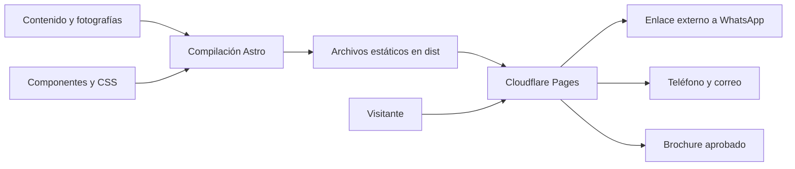

# Arquitectura del proyecto CONSUC SAC

Estado: arquitectura actualizada al alcance de landing page, previa al desarrollo.
Actualización: 19 de noviembre de 2026.

## Objetivo y alcance actual

Desarrollar una landing corporativa en español que presente CONSUC SAC, explique sus seis categorías de servicios y facilite el contacto por WhatsApp, teléfono y correo. Todo el contenido principal se muestra en una página con navegación por secciones.

La primera versión incluye diseño responsive, identidad visual del brochure, fotografías aprobadas, contenido empresarial, servicios, descarga del brochure y enlaces de contacto. Las páginas independientes de servicio, panel, formularios, adjuntos, base de datos, autenticación y portal de clientes quedan para ampliaciones futuras.

Esta decisión sustituye la arquitectura inicial con Next.js y PostgreSQL, que respondía al alcance completo. No se necesita mantener un servidor ni contratar una base de datos para la landing.

Fuentes: `guia_estilo_y_disenio.md`, brochure de seis páginas y referencias entregadas por el usuario. El brochure aporta contenido e identidad, no instrucciones de desarrollo. Los datos pendientes de confirmación no se presentan como verificados.

## Tecnologías

| Tecnología | Responsabilidad |
| --- | --- |
| Astro | Generar HTML estático para la landing y futuras páginas de contenido. |
| TypeScript | Tipar datos, configuración y utilidades. |
| CSS | Estilos por componente y variables de marca; aprovechar los tokens existentes. |
| JSON | Separar empresa, servicios y navegación del diseño. |
| Markdown y colecciones | Incorporarlos al añadir fichas o textos extensos; opcionales para la landing. |
| JavaScript del navegador | Menú móvil y otras interacciones justificadas. WhatsApp funciona como enlace. |
| Cloudflare Pages | Alojamiento estático recomendado, con URL temporal de revisión y dominio posterior. |
| Git | Commits por avance y control de versiones. |

Seleccionar versiones estables compatibles y fijarlas en un archivo de bloqueo al inicializar Astro. Esta actualización no instala dependencias. Incorporar React, CMS o servicios externos solo cuando una función los requiera.

## Flujo del sistema



Los cambios de contenido requieren compilar y desplegar de nuevo. Inicialmente el desarrollador actualiza los archivos mediante Git. WhatsApp abre una conversación con mensaje predefinido; no requiere API, bot ni servidor propio. El clic no acredita envío del mensaje ni genera una consulta registrada.

## Ruta y secciones

Ruta pública inicial: `/`. El menú usa anclas; los slugs de servicios son identificadores de contenido y no crean páginas de detalle en esta etapa.

| Ancla | Contenido |
| --- | --- |
| `#inicio` | Presentación, imagen principal y CTA de WhatsApp. |
| `#nosotros` | Empresa, trayectoria desde 2020, ubicación, misión y visión. |
| `#servicios` | Seis categorías con resumen, alcance y WhatsApp contextual. |
| `#galeria` | Fotografías de operaciones autorizadas; opcional según material disponible. |
| `#clientes` | Nombres o logos aprobados; omitir mientras falte confirmar su publicación. |
| `#seguridad-calidad` | Compromisos documentados y acreditaciones solo con alcance y vigencia revisados. |
| `#contacto` | Teléfonos, correos, dirección, WhatsApp y descarga del brochure. |

El pie contiene razón social, RUC y enlaces útiles. El botón «Cotizar por WhatsApp» abre el contacto externo. La descarga se habilita tras aprobar el PDF y copiarlo a `public/brochure/`. No inventar fichas de proyectos a partir de fotografías.

Las seis categorías se conservan en `src/content/services.json`. `src/content/routes.json` distingue las secciones actuales de las rutas de una posible ampliación.

## Estructura prevista

```text
public/
  brochure/                    # PDF aprobado
  favicon.svg
src/
  assets/                      # Logos y fotografías para optimización
  components/
    layout/                    # Cabecera, menú y pie
    sections/                  # Inicio, Nosotros, Servicios, Galería y Contacto
    ui/                        # Botones, tarjetas y enlace WhatsApp
  content/
    company.json               # Empresa y contactos
    services.json              # Seis servicios
    routes.json                # Ruta, anclas y ampliaciones
  layouts/
    BaseLayout.astro           # HTML base, metadatos y estilos
  pages/
    index.astro                # Composición de la landing
    404.astro
  lib/
    whatsapp.ts                # Generación y codificación de enlaces
  styles/
    tokens.css
    global.css
  contracts/
    inquiry.schema.json        # Referencia futura, fuera de la landing
scripts/
docs/
astro.config.mjs
tsconfig.json
package.json
```

Este árbol es una estructura de implementación, no una aplicación ya creada. Actualmente existen JSON, tokens, contrato futuro y comprobación de arquitectura. Astro y la interfaz aún no están instalados.

Las secciones reciben datos y componen componentes. Leer contactos de una sola fuente; evitar números y correos repetidos en el marcado. Mantener las utilidades independientes del contenido editorial. La escala inicial no requiere microservicios, monorepositorio ni capas de acceso a bases de datos.

## Diseño, contenido y accesibilidad

Preservar azul `#1C2A39`, naranja `#F27D16`, verde `#54B948`, blanco y gris hielo. Usar Montserrat e Inter cuando se incorporen archivos con licencia, con alternativas del sistema. Cuerpo desde 16 px y títulos fluidos mediante `clamp()`.

Conservar encabezados numerados, subrayados de 60 × 4 px, viñetas cuadradas, fotos con radio de 10 px y etiquetas azules con borde naranja. Ajuste a la guía: texto azul oscuro sobre botones naranjas para mejorar el contraste. Distinguir las cuatro líneas corporativas del brochure de las seis categorías web.

Revisar las variantes de logo existentes en la raíz; conservar originales y generar derivados optimizados. Imágenes con tamaños adecuados, dimensiones declaradas y formatos modernos; carga diferida fuera de la vista inicial, sin diferir la imagen principal. Usar fotos reales autorizadas, con texto alternativo. No representar trabajos de CONSUC con imágenes generadas.

HTML semántico, un H1, jerarquía de títulos, enlace para saltar al contenido y foco visible. Menú móvil con teclado, estado expandido y cierre con Escape. Respetar movimiento reducido.

Clientes, AWS, SGS y código vendor siguen `fuentes-y-contenido.md`. No inventar resultados, coordenadas o enlaces sociales. Si falta material, continuar con las demás secciones y omitir lo pendiente de confirmación.

## Publicación y posicionamiento

Desarrollar localmente primero. Se recomienda Cloudflare Pages para la primera propuesta, con URL temporal `pages.dev`, y dominio propio al aprobar la versión final. Esta actualización documental no publica el sitio ni cambia la visibilidad del repositorio.

Compilación prevista: `npm run build`; salida `dist/`. El despliegue desde Git se configura cuando exista acceso autorizado a las plataformas. Una vez vinculado, un push a la rama elegida puede publicar cambios; los commits locales se mantienen separados de la publicación.

Astro también puede generar una versión para GitHub Pages. Si se elige, configurar URL y ruta base del repositorio y comprobar rutas de imágenes/PDF y condiciones de uso. No es necesario resolverlo para iniciar el desarrollo local.

Incluir título, descripción, idioma, favicon y metadatos para compartir. Configurar URL canónica y sitemap con el dominio definitivo. Las vistas de revisión usarán `noindex`, que no equivale a privacidad ni control de acceso. No publicar material confidencial.

No añadir analítica, cookies de seguimiento, formularios o mapas de terceros por defecto. Revisar sus implicaciones si se solicitan. Dominio y cuentas deben quedar bajo control del cliente o con un acuerdo claro de administración; no hace falta comprar dominio para empezar.

## Verificación de entrega

- Catálogo de seis servicios coherente y navegación mediante anclas.
- Compilación y comprobación de tipos tras instalar Astro.
- Revisión visual a 360, 768 y 1440 px, sin desbordamientos.
- Teclado, foco, menú móvil y jerarquía de títulos comprobados.
- WhatsApp con número confirmado, mensaje por servicio y codificación correcta; verificar destinos sin enviar mensajes.
- Teléfonos, correos, imágenes, anclas y PDF sin enlaces rotos.
- Contenido aprobado y metadatos de producción antes de publicar.

`node scripts/check-architecture.mjs` verifica el inventario inicial; no certifica una interfaz terminada ni servicios inexistentes. No ejecutar pruebas de API, usuarios o base de datos que no forman parte de la landing.

## Recursos disponibles y datos necesarios

Ya disponibles: guía visual, brochure original en el escritorio, catálogo inicial, contactos del brochure, tokens CSS y seis archivos de logo en la raíz. Revisar estos recursos antes de pedir material adicional.

| Pendiente | Momento y tratamiento |
| --- | --- |
| WhatsApp principal con código de país | Necesario para activar CTA finales. Los dos teléfonos del brochure no identifican cuál usa WhatsApp. El diseño puede avanzar sin asumir un número. |
| Confirmar teléfonos, correos y dirección públicos | Antes de revisión final; usar el inventario existente como borrador. |
| Fotos originales y cuáles corresponden a trabajos propios | Revisar primero el brochure y aprovechar material autorizado. Mejoran la galería, pero no bloquean la estructura. |
| Clientes/logos y afirmaciones AWS/SGS que se pueden publicar | Confirmar antes de mostrar esos elementos; pueden omitirse mientras se revisan. |
| PDF final autorizado para descarga | Ya existe el brochure; confirmar que puede publicarse y no requiere cambios. |
| Dominio y acceso al repositorio/alojamiento | Solo al configurar despliegue, mediante autorización de las plataformas. No solicitar contraseñas o tokens por el chat. |

Se puede comenzar la estructura y el diseño con el material existente. Los pendientes condicionan activar contactos y publicar elementos concretos, no inicializar Astro. La variante de logo se elige tras revisar los originales y se presenta en la propuesta visual.

## Evolución posterior

| Necesidad | Ampliación |
| --- | --- |
| Más páginas y casos | Rutas de servicios/proyectos y colecciones de contenido. |
| Edición por CONSUC | CMS conectado a Astro y reconstrucción o actualización tras publicar. |
| Cotizaciones y adjuntos | Backend o rutas de servidor, validación, protección contra abuso, archivos privados y persistencia. |
| Seguimiento | Usuarios, permisos y base de datos según el flujo comercial definido. |
| Portal de clientes | Acceso por cliente/proyecto y posible aplicación independiente; evaluar Next.js al concretar ese alcance. |

Astro admite rutas de servidor mediante adaptador; incorporarlas requiere revisar alojamiento y costos. No asumir que un portal completo se obtiene automáticamente de la landing ni que todas las funciones futuras caben en hosting estático gratuito.

`docs/datos-y-flujos.md` y `src/contracts/inquiry.schema.json` quedan como referencias futuras, no requisitos de esta entrega.
