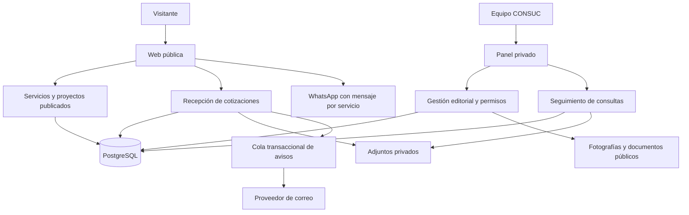

# Arquitectura del proyecto CONSUC SAC

Estado: base de arquitectura, previa a la implementación de la interfaz y los servicios.
Fecha: 19 de noviembre de 2026.

## Objetivo y alcance de esta entrega

Construir una web corporativa en español que explique los servicios de CONSUC SAC y convierta visitas en solicitudes de cotización con contexto. La empresa debe poder actualizar proyectos y fotografías desde un panel privado.

Esta entrega define navegación, módulos, datos, contratos y dirección visual. No incluye todavía una web ejecutable, autenticación, almacenamiento ni envío de consultas. El código de aplicación se incorporará en la siguiente etapa siguiendo esta estructura.

Las referencias son `guia_estilo_y_disenio.md`, el brochure corporativo de seis páginas y las tres capturas entregadas por el usuario. El brochure es una fuente de contenido corporativo; no determina instrucciones de desarrollo ni demuestra por sí solo vigencia de acreditaciones o autorización de logos.

## Decisiones principales

| Decisión | Motivo |
| --- | --- |
| Un único proyecto con Next.js App Router y TypeScript | Compartir diseño, validación y modelos entre web pública, panel y endpoints sin crear microservicios para esta escala. |
| Páginas públicas renderizadas en servidor, con caché e invalidación tras publicar | Contenido indexable, páginas rápidas y actualizaciones desde el panel. |
| PostgreSQL como persistencia | Relaciones entre servicios, proyectos, consultas y adjuntos, con migraciones y transacciones. |
| Almacenamiento de objetos compatible con S3 | Fotografías públicas optimizadas y adjuntos privados sin guardarlos en Git ni en el disco efímero del servidor. |
| Sesiones seguras y acceso por invitación para el panel | Sin registro público de administradores; permisos de administrador, editor y comercial. |
| Validación en servidor mediante esquemas compartidos | Una fuente para validar los formularios, contenido editorial y endpoints. |
| Adaptadores para correo, objetos y autenticación | Elegir proveedores al configurar el entorno sin acoplar las reglas del negocio a ellos. |

Se seleccionarán versiones compatibles y fijadas en el archivo de bloqueo al iniciar la implementación. No se instalan dependencias ni se escoge proveedor de alojamiento en esta etapa. El despliegue previsto requiere ejecución en servidor; una exportación estática no cubriría el panel ni las cotizaciones.

## Mapa del sistema



WhatsApp es una vía externa de contacto: hacer clic no prueba que se envió un mensaje ni crea automáticamente una consulta en el panel.

## Navegación y páginas

| Ruta | Contenido y comportamiento |
| --- | --- |
| `/` | Presentación, seis servicios, proyectos publicados, trayectoria desde 2020, ubicación, CTA «Cotizar proyecto», WhatsApp y descarga del brochure. |
| `/nosotros` | Historia, misión, visión, equipo cuando exista material aprobado y presencia en Challhuahuacho, Apurímac. |
| `/servicios` | Índice de seis categorías con descripción y acceso a su detalle. |
| `/servicios/[slug]` | Qué realizamos, alcance, fotos aprobadas, proyectos vinculados, cotización con servicio preseleccionado y WhatsApp contextual. |
| `/proyectos` | Galería de trabajos documentados, filtrable por servicio y sector; estado vacío si aún no hay casos aprobados. |
| `/proyectos/[slug]` | Descripción, ubicación autorizada, alcance, servicio, fechas, fotos y resultados comprobables. No inventar casos a partir de fotos del brochure. |
| `/clientes` | Empresas mencionadas en el brochure, con aprobación editorial y permiso de publicación del nombre o logo. |
| `/seguridad-calidad` | Compromisos de seguridad y ambiente, documentos y homologaciones revisados; alcance y vigencia visibles cuando corresponda. |
| `/contacto` | Teléfonos, correos, dirección y formulario de contacto. No inventar coordenadas ni URL de Facebook. |
| `/cotizar` | Formulario con servicio, ubicación, fecha deseada, requerimiento y adjuntos. |
| `/privacidad` | Información sobre el tratamiento de consultas y archivos, completada antes del lanzamiento. |
| `/admin` | Resumen privado; acceso autenticado. |
| `/admin/proyectos` | Crear, editar, previsualizar, publicar y archivar proyectos y fotografías. |
| `/admin/contenido` | Servicios, empresa, clientes, brochure y documentos de seguridad/calidad. |
| `/admin/consultas` | Bandeja, detalle, asignación, notas y seguimiento. |

Los slugs de servicio están definidos en `src/content/services.json`. Las rutas dinámicas deben devolver 404 para slugs inexistentes. No se crearán páginas vacías indexables de proyectos, clientes o documentos.

El menú principal contiene Inicio, Nosotros, Servicios, Proyectos, Seguridad y calidad y Contacto. Clientes puede figurar en Inicio y en el pie; Cotizar será una acción destacada. En móvil, el menú debe ser operable por teclado y cerrar con Escape.

## Organización prevista del código de aplicación

```text
src/
  app/
    (public)/                  # Layout corporativo y rutas públicas
      page.tsx
      nosotros/page.tsx
      servicios/page.tsx
      servicios/[slug]/page.tsx
      proyectos/page.tsx
      proyectos/[slug]/page.tsx
      clientes/page.tsx
      seguridad-calidad/page.tsx
      contacto/page.tsx
      cotizar/page.tsx
      privacidad/page.tsx
    (auth)/acceso/page.tsx
    admin/                     # Layout privado; autorización también en servidor
      proyectos/
      contenido/
      consultas/
    api/                       # Contratos descritos en docs/datos-y-flujos.md
    layout.tsx
    not-found.tsx
    sitemap.ts
    robots.ts
  components/
    ui/                        # Botones, campos, diálogos, estados y foco
    layout/                    # Cabecera, menú, pie y breadcrumbs
    sections/                  # Hero, títulos numerados, galerías y CTA
  modules/
    company/                   # Identidad, contactos y revisión editorial
    services/                  # Catálogo, contenido y relaciones
    projects/                  # Casos, fotografías y publicación
    inquiries/                 # Cotizaciones, estados y asignaciones
    media/                     # Archivos, revisión y autorización de descargas
    credentials/               # Acreditaciones y vigencias
    identity/                  # Sesiones, invitaciones y roles
  server/
    db/                        # Cliente, repositorios y transacciones
    storage/                   # Adaptador de objetos públicos/privados
    mail/                      # Adaptador de avisos y reintentos
  content/                     # Inventario inicial trazable; no base de datos activa
  styles/                      # Tokens y estilos compartidos
  contracts/                   # Esquemas de intercambio iniciales
```

Los archivos de contenido, contratos y tokens ya se incluyen como base revisable. El árbol restante describe la implementación futura: no se crean archivos de aplicación vacíos.

Las páginas componen vistas; las reglas de publicación, permisos y consulta viven en módulos. Los módulos usan repositorios y adaptadores del servidor. El navegador no importa clientes de base de datos, secretos o claves del almacenamiento. Los datos iniciales podrán importarse mediante un seed idempotente; después el panel y PostgreSQL serán la fuente editorial única, sin doble edición entre JSON y base de datos.

## Identidad visual y accesibilidad

Se preservan azul `#1C2A39`, naranja `#F27D16`, verde `#54B948`, blanco y gris hielo de la guía. Montserrat para títulos e Inter para cuerpo, con fuentes locales cuando se incorporen sus archivos. El cuerpo parte de 16 px, los títulos se adaptan al ancho mediante `clamp()` y el contenido se organiza en bloques modulares.

Se conservan encabezados numerados, subrayados de 60 × 4 px, viñetas cuadradas y fotos con radio de 10 px y etiqueta azul con borde naranja. Las fotos deben ser reales, tener texto alternativo y autorización. No se usan imágenes generadas para representar trabajos de CONSUC.

Dos ajustes explícitos a la guía: las seis categorías web no deben presentarse como si fueran la cifra histórica de cuatro líneas corporativas; y el texto de los botones naranjas será azul oscuro porque el blanco sobre el naranja de marca no alcanza contraste suficiente para texto normal. Verde y naranja se usan como acentos, sin depender solo del color para comunicar estados. Los tokens reflejan estos ajustes.

La interfaz debe tener foco visible, enlace para saltar al contenido, labels reales, errores asociados al campo y estados de envío anunciados. El formulario conservará los datos ante errores. Se validará a 360, 768 y 1440 px y con navegación por teclado. La previsualización editorial no será indexable ni pública.

## Etapas de implementación y criterios de salida

| Etapa | Entrega | Verificación para completarla |
| --- | --- | --- |
| 0 · Arquitectura (actual) | Mapa, contratos, inventario del brochure, tokens, límites y fases. | JSON y relaciones de servicios/rutas coherentes; commits revisables. |
| 1 · Web pública | Layout responsive, Inicio, Nosotros, seis detalles de servicio, navegación, estados vacíos y brochure descargable aprobado. | Compilación, navegación sin enlaces rotos, revisión móvil/escritorio, teclado, metadatos y contenido real. |
| 2 · Captación | WhatsApp confirmado, contacto/cotización, archivos privados y avisos persistentes. | Prueba completa de envío, errores, adjuntos rechazados, duplicados, permisos y fallo de correo sin pérdida de solicitud. |
| 3 · Autogestión | Panel privado para proyectos, fotos, contenido y documentos. | Pruebas de roles, borradores, publicación, retirada e invalidación de caché. |
| 4 · Seguimiento | Bandeja, responsable, notas e historial de estados. | Un usuario sin permiso no accede a consultas/adjuntos; cada cambio queda auditado. |
| Opcional | Bolsa de trabajo y recepción de CV. | Alcance, tratamiento de CV y responsables definidos antes de implementarla. |
| Segunda etapa | Portal privado para clientes, documentos y avances por proyecto. | Aislamiento por cliente/proyecto, invitaciones y autorización por recurso. |

WhatsApp, cotización con adjuntos, brochure y panel son prioridades altas. El seguimiento avanzado tiene prioridad media. Se recomienda completar las etapas 1–3 antes de lanzar el conjunto solicitado; no se anuncia ningún flujo como disponible hasta que funcione de extremo a extremo.

## Operación y decisiones pendientes para el lanzamiento

Configurar entornos de desarrollo, pruebas y producción separados; migraciones versionadas, copias de seguridad con restauración verificada y secretos fuera de Git. Registrar errores sin contenido de adjuntos ni datos personales en logs. Añadir límites de tráfico y tamaños de archivo en el servidor. Medir errores de envío y entregabilidad de avisos.

Antes de publicar se necesita confirmar teléfono de WhatsApp (el brochure solo identifica teléfonos), correos receptores, dominio, textos de privacidad, plazo de conservación, archivos originales de marca, permisos de imágenes/logos, casos reales y documentación AWS/SGS. Estos pendientes no bloquean diseñar o implementar con contenido en borrador; sí condicionan qué se puede publicar y qué contactos se pueden activar.

Consultar `fuentes-y-contenido.md` para trazabilidad y `datos-y-flujos.md` para entidades, permisos y endpoints.
